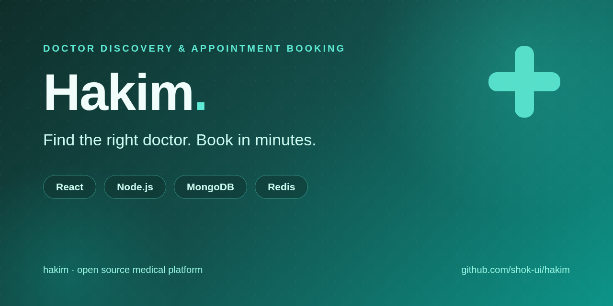
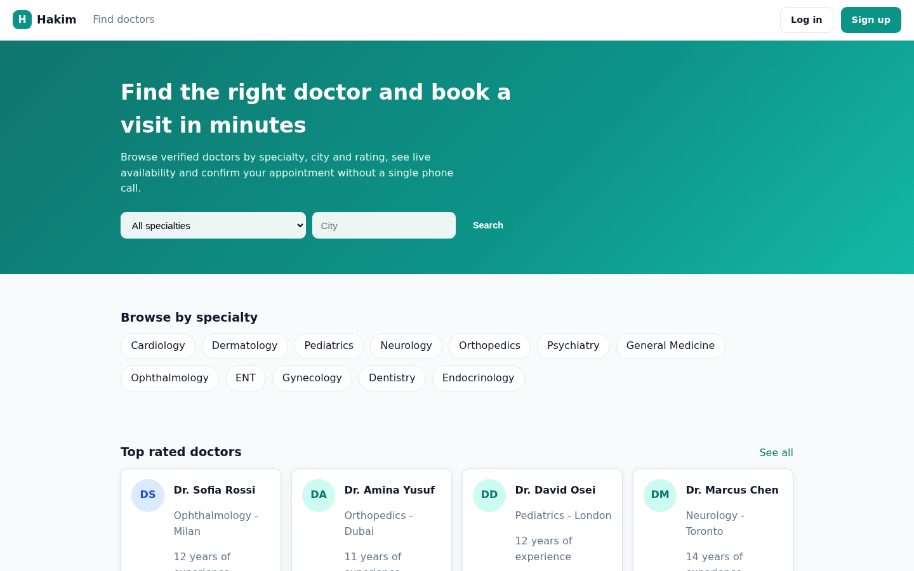
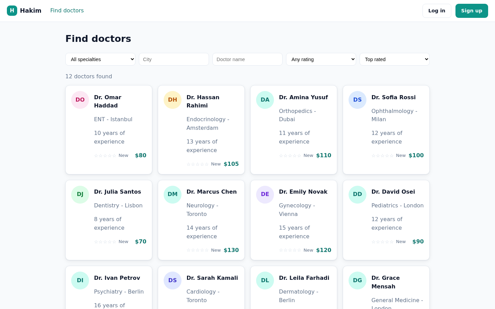
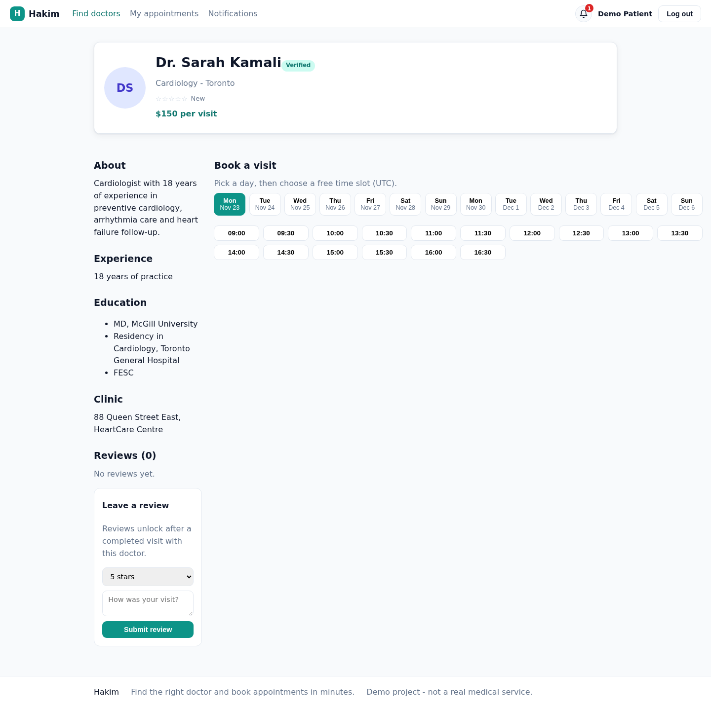
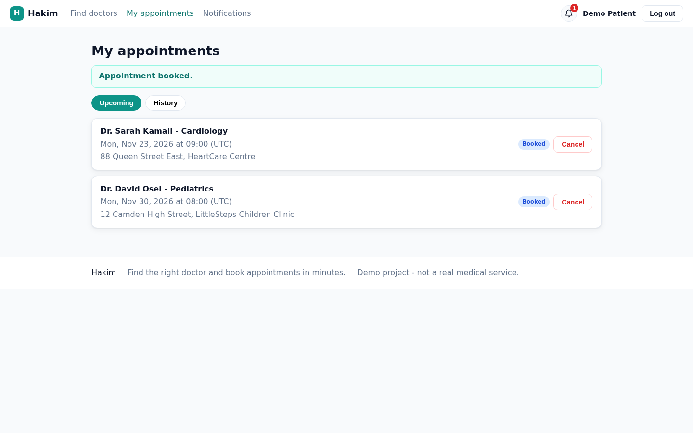
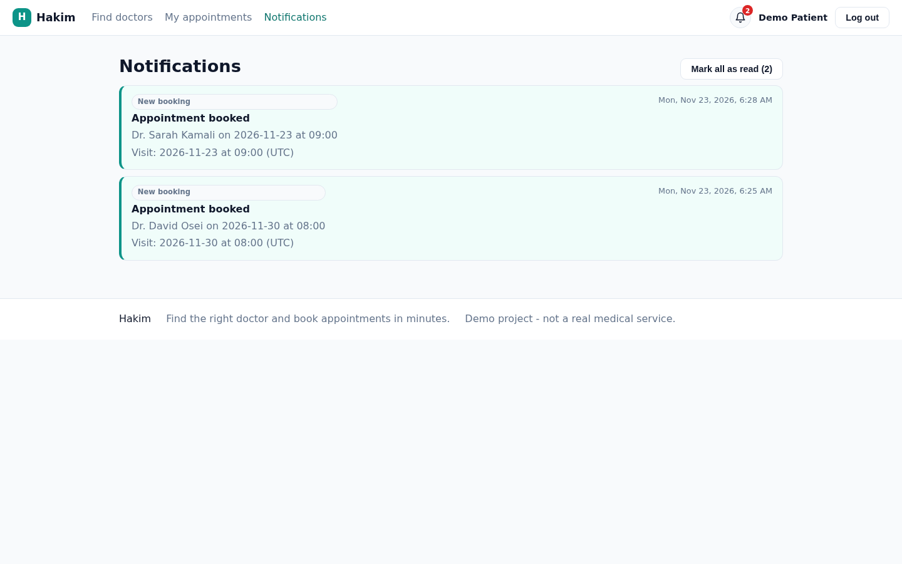
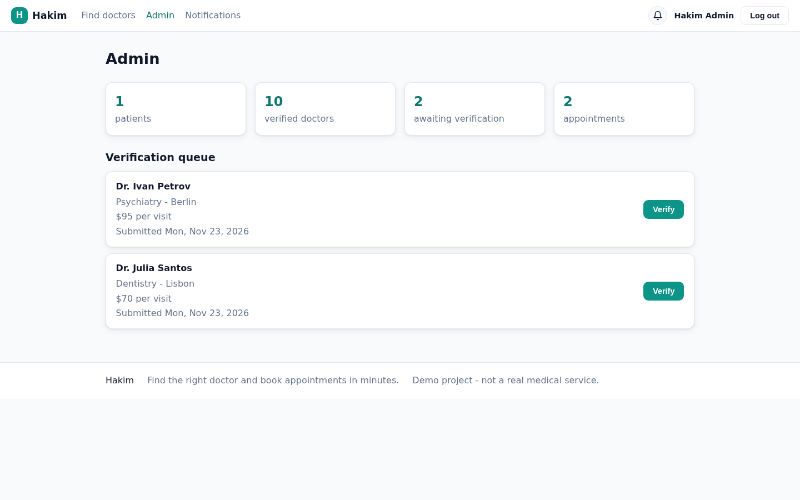
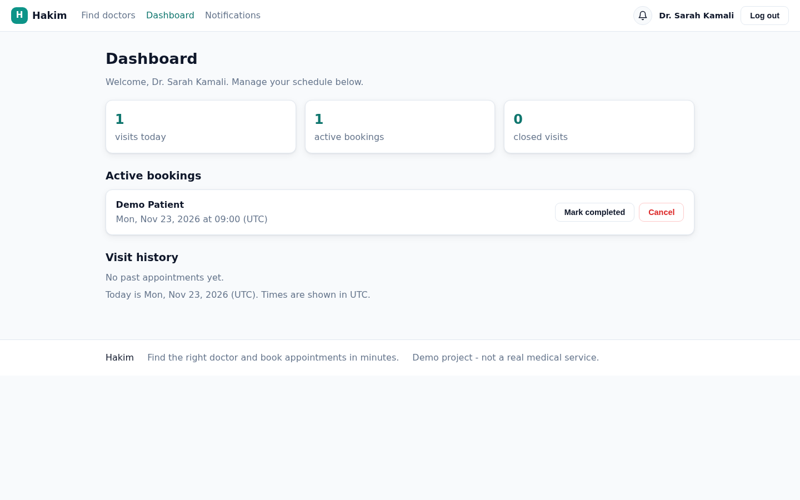

# Hakim



Find the right doctor and book medical appointments in minutes.

Hakim is a full-stack medical appointment platform. Patients discover verified doctors by specialty, city, rating and fee, check live availability and book a visit in a few clicks. Doctors manage their queue (complete visits, mark no-shows, cancel) and admins keep the directory clean. Both sides get an in-app notification inbox, and a symptom-based recommender suggests the right specialty when patients are not sure who to see.


## Screenshots

| Home | Find doctors |
| --- | --- |
|  |  |

| Doctor profile and slot booking | My appointments |
| --- | --- |
|  |  |

| Notifications | Admin panel |
| --- | --- |
|  |  |

| Doctor dashboard | |
| --- | --- |
|  | |

## Features

- **Doctor discovery** - filter the directory by specialty, city, minimum rating and maximum fee, search by name, sort by rating, experience or price. Results are cached in Redis for fast repeat searches.
- **Doctor profiles** - bio, years of experience, clinic address, consultation fee, verified badge and patient reviews with star ratings.
- **Smart booking** - each doctor defines weekly work days and a working window; the API expands it into bookable slots (30-minute by default, configurable per doctor) and disables past days, non-working days and taken slots. Availability is cached and invalidated on every booking or cancellation.
- **Double-booking protection** - a short Redis lock turns racing requests into a clean 409, and a MongoDB partial unique index on active appointments is the final guarantee.
- **Appointment lifecycle** - patients book instantly into a free slot; doctors complete visits, mark no-shows or cancel, and both sides keep a full history with upcoming/past filters. Patients can also reschedule a booked visit into any other free slot of the same doctor.
- **Notifications** - in-app inbox with an unread badge (polled once a minute): booking confirmations for patients, cancellation alerts for doctors and profile-verification alerts.
- **Reviews** - only patients with a completed appointment at a doctor can rate them (1-5 stars, one review per patient per doctor). Rating aggregates are stored on the doctor document.
- **Roles** - patient, doctor and admin. New doctor profiles enter an admin verification queue before becoming public.
- **Bilingual UI** - full English + Persian (Farsi) interface with a one-click language switcher, right-to-left layout, locale-aware dates and a persisted language choice. English is the default everywhere (code, commits, docs and UI).
- **Security** - JWT authentication, bcrypt password hashing, role-based access control, strict input validation with Zod and Redis-backed rate limits (global, login, registration and booking).

## Architecture

```
client/                 React 18 SPA (Vite, React Router)
  src/api/              fetch wrapper with token handling
  src/i18n/             lightweight i18n provider + en/fa dictionaries
  src/components/       navbar, cards, slot picker, guards, language switcher
  src/pages/            home, directory, profile, auth, dashboards
  src/styles/           single hand-written stylesheet (incl. RTL overrides)
server/                 Node.js 18+ REST API (Express)
  src/config/           env, MongoDB, Redis connections
  src/models/           Mongoose schemas (User, Doctor, Appointment, ...)
  src/middleware/       auth, rate limiting, central error handler
  src/services/         slots, booking, cache, notifications, reminders
  src/controllers/      route handlers
  src/scripts/          demo data seeder
  tests/                unit tests (node:test)
```

Where Redis is used:

| Key pattern | Purpose | TTL |
| --- | --- | --- |
| `doctors:list:<hash>` | cached directory queries | 60s |
| `avail:<doctorId>:<date>` | cached day availability | 120s |
| `specialties:all` | cached specialty list | 300s |
| `lock:apt:<doctorId>:<slot>` | booking lock against races | 15s |
| `rl:*` | rate limiting counters | per-route window |

## Tech stack

| Layer | Tools |
| --- | --- |
| Frontend | React 18, Vite 5, React Router 6, hand-written CSS, custom i18n (en/fa + RTL) |
| Backend | Node.js (ESM), Express 4, Mongoose 8 |
| Data | MongoDB 7, Redis 7 |
| Auth | JWT (jsonwebtoken), bcryptjs |
| Ops | Docker Compose, GitHub Actions CI, pino logging |

## Quick start (local)

Requirements: Node.js 18.17+, MongoDB and Redis running locally (or via Docker).

1. Start the databases:

```bash
docker run -d --name hakim-mongo -p 27017:27017 mongo:7
docker run -d --name hakim-redis -p 6379:6379 redis:7-alpine
```

2. Run the API:

```bash
cd server
npm install
cp .env.example .env
npm run seed     # demo admin, patient and doctor accounts
npm run dev      # http://localhost:4000
```

No MongoDB installed? The API can boot its own in-memory MongoDB and seed it automatically (demo and CI only, data resets on restart):

```bash
USE_MEMORY_DB=true npm start
```

3. Run the client:

```bash
cd client
npm install
npm run dev      # http://localhost:5173 (proxies /api to port 4000)
```

For a single-process deployment build the SPA once and let the API serve it:

```bash
cd client && npm run build && cd ../server && npm start   # http://localhost:4000
```

## Demo accounts

Created by `npm run seed`:

| Role | Email | Password |
| --- | --- | --- |
| Admin | admin@hakim.health | Hakim#12345 |
| Patient | patient@hakim.health | Hakim#12345 |
| Doctor | sarah.kamali@hakim.health | Hakim#12345 |
| Doctor | david.osei@hakim.health | Hakim#12345 |
| Doctor | leila.farhadi@hakim.health | Hakim#12345 |

## Docker

The compose file builds both apps and wires them together:

```bash
cp .env.example .env
docker compose up -d --build
```

- Client: http://localhost:5173 (nginx serves the SPA and proxies `/api`)
- API: http://localhost:4000/health

## API overview

| Method | Endpoint | Auth | Description |
| --- | --- | --- | --- |
| POST | `/api/auth/register` | - | Sign up as patient or doctor |
| POST | `/api/auth/login` | - | Log in, returns a JWT |
| GET | `/api/auth/me` | any | Current profile |
| GET | `/api/doctors` | - | Directory with filters, sorting, paging |
| GET | `/api/doctors/specialties` | - | Specialty list |
| GET | `/api/doctors/:id` | - | Public profile with latest reviews |
| GET | `/api/doctors/:id/slots` | - | Availability for `?date=YYYY-MM-DD` |
| PUT | `/api/doctors/me` | doctor | Update own profile |
| POST | `/api/doctors/:id/reviews` | patient | Review after a completed visit |
| POST | `/api/appointments` | patient | Book a slot |
| GET | `/api/appointments/mine` | patient/doctor | `?scope=upcoming` or `history` |
| PATCH | `/api/appointments/:id/confirm` | doctor | Confirm a pending request |
| PATCH | `/api/appointments/:id/complete` | doctor | Mark a visit as completed |
| PATCH | `/api/appointments/:id/cancel` | parties | Cancel while pending/confirmed |
| GET | `/api/notifications` | any | Inbox with unread count |
| GET | `/api/notifications/unread-count` | any | Badge value |
| PATCH | `/api/notifications/:id/read` | any | Mark one (`all` marks everything) |
| GET | `/api/admin/doctors/pending` | admin | Verification queue |
| PATCH | `/api/admin/doctors/:id/verify` | admin | Approve a doctor profile |
| GET | `/api/admin/stats` | admin | Platform counters |
| GET | `/health` | - | Liveness probe |

Errors always return `{ "message": "...", "details": [...]? }` with a proper HTTP status (400, 401, 403, 404, 409, 429, 500).

## Internationalization (English + Persian)

The UI ships in two languages out of the box:

- **English** (`en`) - the default for code, commits, documentation and the interface itself.
- **Persian / Farsi** (`fa`) - full translation with a right-to-left layout, Persian date formatting (`fa-IR` calendar names) and the Vazirmatn web font.

How it works:

- `client/src/i18n/index.jsx` exposes a small React context (`I18nProvider` + `useI18n`) with a flat `t(key, params)` dictionary lookup and `{param}` interpolation. No runtime dependency, no build step.
- Dictionaries live in `client/src/i18n/locales/en.js` (source of truth) and `fa.js`. The provider syncs `<html lang>` and `<html dir>` on every switch, so RTL styling (logical-property overrides in CSS) is applied automatically.
- The active language is persisted in `localStorage` (`hakim.lang`) and restored on the next visit.
- `npm run check:locales` fails CI when a locale drifts out of parity with English (missing keys, unknown keys or mismatched placeholders).

Adding a third language takes three steps: create `locales/xx.js`, register it in the `LOCALES` map (dictionary + direction + date locale), and add one button to `LanguageSwitcher.jsx`.

## Configuration

The API reads these variables (see `server/.env.example`):

| Variable | Default | Purpose |
| --- | --- | --- |
| `PORT` | `4000` | HTTP port |
| `NODE_ENV` | `development` | Log level and behavior |
| `CLIENT_ORIGIN` | `http://localhost:5173` | CORS origin |
| `MONGODB_URI` | `mongodb://127.0.0.1:27017/hakim` | Database connection |
| `REDIS_URL` | `redis://127.0.0.1:6379` | Cache and locks |
| `JWT_SECRET` | dev fallback | Token signing key |
| `JWT_EXPIRES_IN` | `7d` | Token lifetime |
| `SLOT_MINUTES` | `30` | Slot grid size |
| `MAX_BOOKING_DAYS_AHEAD` | `60` | Booking horizon |

## Tests

```bash
cd server
npm test
```

Unit tests cover the slot engine (alignment, working hours, weekends, past filtering) and input validators. CI runs the same suite plus a production build of the client on every push.

## Disclaimer

Hakim is a demonstration project. It is not a certified medical device and must not be used to provide real healthcare services.

## License

[MIT](LICENSE)
